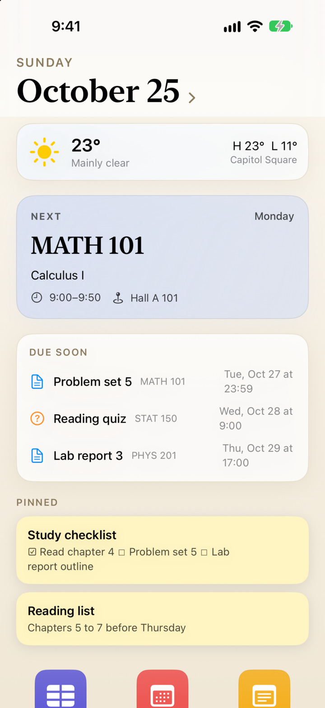
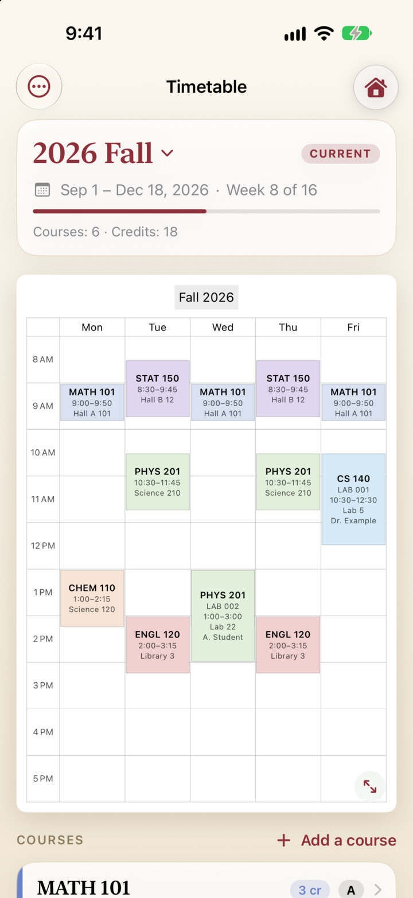
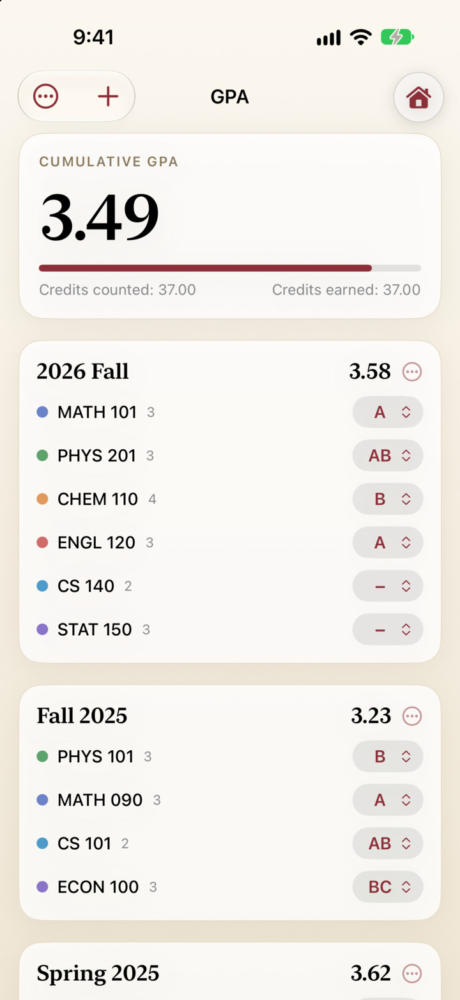
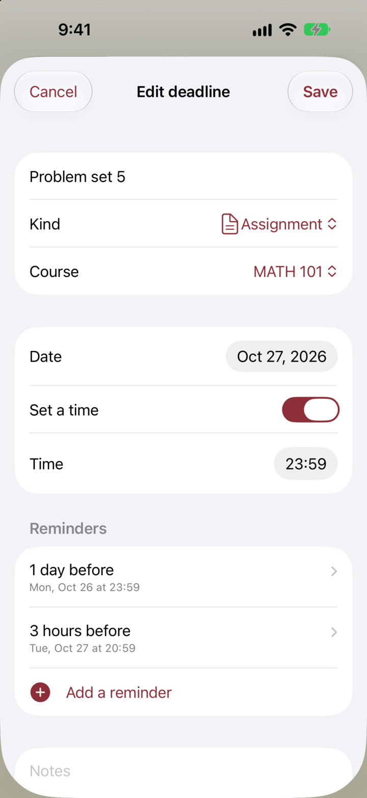

  

<h1 align="center">Kitbag</h1>

<b>One iPhone app that holds a student's everyday tools behind a Today screen, and runs other apps inside itself.</b>

  <a href="https://github.com/kosuke-apps/Kitbag/releases/latest"><b>Download</b></a> &nbsp;·&nbsp;
  <a href="#install">Install</a> &nbsp;·&nbsp;
  <a href="PRIVACY.md">Privacy</a> &nbsp;·&nbsp;
  <a href="https://github.com/kosuke-apps">More apps</a>

  
  
  
  

## What it does

- See your day at a glance: the date, the weather, the class that is on or comes next, what is due soon and your pinned notes.
- Keep your timetable as a weekly page in the look of a printed school timetable, and export it as a PDF.
- Follow your GPA term by term, with grading systems you can change and what-if calculators.
- Keep track of deadlines with reminders you choose for each one, and Done and Snooze buttons right on the notification.
- Write notes in Markdown with photos and files, and read the weather on one screen.
- Open two more apps inside it, full screen, in a single install slot: Headway (a live bus map of Madison) and Mantissa
  (an offline exact calculator).

## Install

Kitbag is not in the App Store. Each release is an unsigned `.ipa`, on purpose: sign it with your own Apple ID through a
sideloading tool such as AltStore or Sideloadly. The author has not tried this route; the details, the limits of a free
Apple ID and the way the author installs it are under [Install in detail](#install-in-detail).

1. Download `Kitbag-x.y.z-unsigned.ipa` and its `.sha256` from the [latest release](https://github.com/kosuke-apps/Kitbag/releases/latest).
2. Check the file: `shasum -a 256 -c Kitbag-x.y.z-unsigned.ipa.sha256`.
3. Open the `.ipa` in the sideloading tool and install it on your iPhone.

## Privacy

No account, no analytics, no advertising and no server of its own: nothing about you or your phone is sent to the author.
Your timetable, deadlines, notes and grades stay on the phone. The weather, the place search and the calendars you
subscribe to by address use the network. [`PRIVACY.md`](PRIVACY.md) lists every address, and covers Headway and Mantissa.

## About

With a free Apple ID, an app you sideload is widely reported to stop launching after 7 days, and a device to hold only
three such apps at a time (that comes from the sideloading tools' pages and community reports, not from Apple's
documentation). Kitbag takes one of those slots: tap an app icon on its home screen and the app opens full screen inside
Kitbag; tap the house button at the top right to come back.

Kitbag began as the author's own everyday tool as a student, and is meant for any student, at any school.

This app was built with the help of Claude (Anthropic) through Claude Code; design, review and testing are by Kosuke Satake. Anthropic does not endorse this app.

## Features

- A home screen with today's date, the class that is on or comes next, and the day's classes, above a grid of app icons;
  each tool opens inside Kitbag.
- Timetable: terms (semesters) with their dates, the week as an A4 page in the look of a printed school timetable (pastel
  blocks as tall as the class), a PDF export of that page, course cards with credits, course details with grade, deadlines
  and notes, and import and export as a readable JSON file.
- GPA: grades per course for any term (an old term can be entered with just its courses, credits and grades, no timetable
  needed), the cumulative GPA over the terms that count, a term graded on its own scale (study abroad) or left out of the
  cumulative GPA, courses left out or taken pass/fail, your own grading systems, credits earned, and a what-if
  calculator (imagined grades, imagined courses, courses left out) and the average a target GPA needs.
- Calendar: deadlines (assignments, exams, quizzes, projects) with as many local-notification reminders as you like (a day
  before, three hours before, on the morning...), set per kind of deadline and shown with the exact moment each will come,
  with Done and Snooze buttons on the notification itself, a month page with the
  day's classes and deadlines, and a list grouped by how soon each is due. Import a calendar file (`.ics`) after a
  preview, export deadlines or a term's classes as `.ics`, and subscribe to a Canvas or Google calendar by its address:
  its events show beside yours and on Today (the address stays in the keychain).
- Notes: Markdown that is styled as you type (headings, bold, italic, strike, code, links, checklists you can tick,
  numbered and bulleted lists, quotes) with a format bar above the keyboard, photos and files kept with the note,
  search, an optional course, and a pin that shows the note on the Today screen.
- Weather: everything on one screen, with no scrolling: now, a strip of days from a week back to ten ahead, a chart and
  an hourly table (temperature, feels like, rain chance and amount, wind and gusts, humidity, cloud, UV, pressure) for
  the day you pick, and the day's totals; for a place you search for, or your location. Data by
  [Open-Meteo](https://open-meteo.com/) (CC BY 4.0).
- Backup: Settings > Data exports everything (timetable, deadlines, notes with photos and files, settings) as one `.kitbag`
  file to send by AirDrop or keep in Files, and restores one (after asking, and after saving what was there). It is also the
  way to move to another iPhone. iCloud sync itself needs the iCloud capability, which a free Apple ID cannot use, so instead
  a backup folder you pick (in iCloud Drive, for example) takes a dated backup once a day, for another iPhone or iPad to
  restore.
- Widgets: the class on now or next, the day's list and the whole week as a timetable, and what is due next (tap a circle
  to mark one done), on the home screen and the lock screen.
- Settings: a language (system, English, 日本語) for Kitbag, its tools and the apps inside it, five colour themes and five styles (Classic, Glass, Bento, Editorial, Compact: the shapes and layout of Today and of every
  card, apart from the colours), light or dark, five app icons, and which tools and which parts of Today are shown and in what
  order.
- Headway (live Madison bus map) and Mantissa (offline exact calculator) run inside it as guests, from their own
  repositories, unchanged.
  The punctuality percentages in Headway are statistics of the City's live feeds that Headway recorded itself, so they are
  rough until many days are recorded; the notes of each Release say how many days and which dates the bundled file covers.

## Install in detail

Apple only runs signed apps, so there are two ways.

**Take a release build (no build needed, but a second tool is).** Each
[release](https://github.com/kosuke-apps/Kitbag/releases) has an unsigned `Kitbag-<version>-unsigned.ipa` and its
checksum. Check the download with `shasum -a 256 -c Kitbag-<version>-unsigned.ipa.sha256`, then install the `.ipa` with a
sideloading tool that signs with your own Apple ID, such as [AltStore](https://altstore.io) or
[Sideloadly](https://sideloadly.io). The file is deliberately unsigned, so it carries no signature of mine. With a free
Apple ID, such tools are widely reported to install an app that stops opening after 7 days (it has to be signed again) and
to allow three apps at a time; that comes from the tools' own pages and community reports, not from Apple's documentation,
so check the tool's page for the current limits. Kitbag's widgets and its keychain use entitlements (an App Group, a
keychain group) that an unsigned file does not carry; a tool that does not add them leaves the widgets empty. The author
has not tried this route; the file is checked only as far as its contents (unsigned, licence texts present, no personal
data).

**Build it yourself (how the author installs it).** You need a Mac with Xcode 27 and
[XcodeGen](https://github.com/yonaskolb/XcodeGen), and, for Headway's data, [pmtiles](https://github.com/protomaps/go-pmtiles)
and Node (`brew install xcodegen pmtiles node`).

1. `tools/fetch_guests.sh` checks out [Headway](https://github.com/kosuke-apps/Headway) and
   [Mantissa](https://github.com/kosuke-apps/Mantissa) next to this folder, at the release tags that `tools/guests.txt`
   pins. A checkout that already exists is left alone.
2. Build Headway's data once, with Headway's own tools (see its README):
   `cd ../Headway && tools/fetch_basemap.sh && tools/fetch_timetable.sh && tools/build_punctuality.sh`. It is the map of
   Madison (OpenStreetMap data, a Protomaps build) and the City of Madison's transit timetable. Neither repository contains
   that data: the City's terms apply to its feeds and to anything derived from them, so you fetch it yourself (Headway's
   `docs/data-sources.md` summarises the terms).
3. `tools/sync_guests.sh`
4. `xcodegen generate`
5. Open `Kitbag.xcodeproj`, or:
   `xcodebuild -project Kitbag.xcodeproj -scheme Kitbag -destination 'platform=iOS Simulator,name=iPhone 18 Pro' -derivedDataPath build/DerivedData build CODE_SIGNING_ALLOWED=NO`

To run on an iPhone with a free Apple ID, copy `Config/Local.xcconfig.example` to `Config/Local.xcconfig` and put your team
in it. `tools/make_unsigned_ipa.sh` builds the release file (`build/release/Kitbag-<version>-unsigned.ipa` and its checksum).

## Keeping it installed (free Apple ID)

A build signed with a free Apple ID stops opening after seven days, and the signature only gets a new seven days when
Xcode asks Apple for a new provisioning profile. Kitbag shows what is left at the bottom of the home screen (and in
Settings) and warns with a notification two days before, the evening before and on the day.

`tools/refresh_device.sh` renews it from the Mac without opening Xcode (it uses the one iPhone that is paired; with several, set `KITBAG_DEVICE` to the name of the one to renew): it moves this app's provisioning profile aside so
that the build fetches a new one, builds for the phone and installs with `devicectl`, over the local network or, when the phone is plugged in, over a USB
cable (whichever the phone can be reached by; no AirDrop; over the network the phone and the Mac must be on the same
Wi-Fi, and the phone must be awake). It waits up to a few minutes for the
phone to be reachable and, if it is not, tries again later. The phone must be paired for network use once (Xcode >
Window > Devices and Simulators > "Connect via network"). `tools/refresh_device.sh --check` says when it last ran and
whether the phone is reachable. `tools/install_refresh_agent.sh` installs a launchd agent that runs it every hour and does
something only once the last install is four days old (`--remove` takes it away); it makes no sound and shows nothing, the
result is in `~/Library/Logs/KitbagRefresh.log` (`KITBAG_NOTIFY=1` adds macOS notifications). Installing over a running app
closes it; the app's data stays.

## Architecture

Guests are pinned release tags of other repositories, built as separate modules inside Kitbag without changing them.
`docs/guests.md` explains how, what a guest needs from the host, and how to upgrade one.

## Quality checks

- Test: `swift test`
- Format: `xcrun swift-format format -i -r App Sources Tests Package.swift`
- Lint: `xcrun swift-format lint --strict -r App Sources Tests Package.swift`
- Build: the `xcodebuild` command above
- Visual: run in the iOS Simulator, open each guest, tap the house button

## Licence

MIT, Copyright (c) 2026 Kosuke Satake. Third-party material is listed in `THIRD_PARTY.md`.
